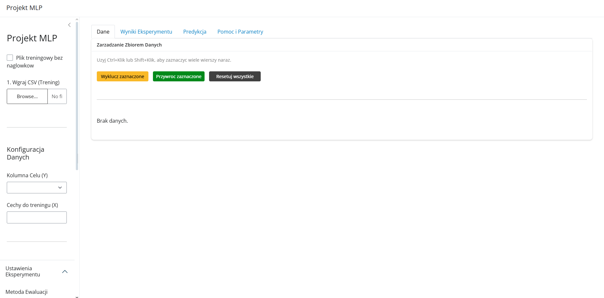
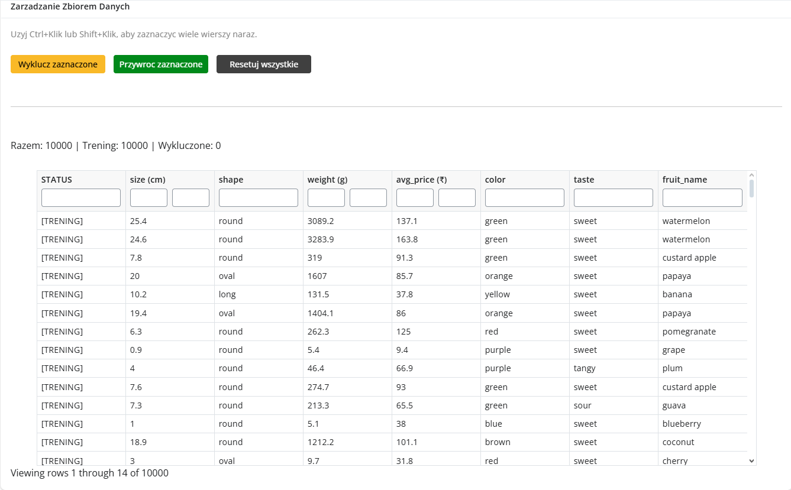
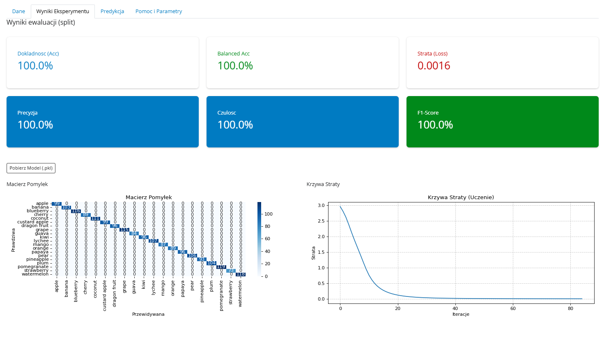
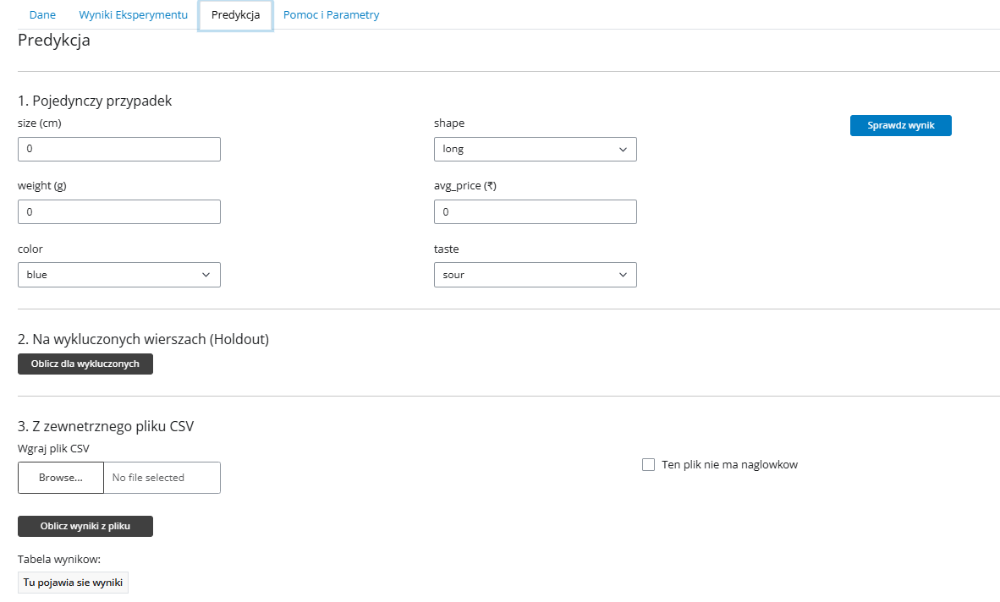
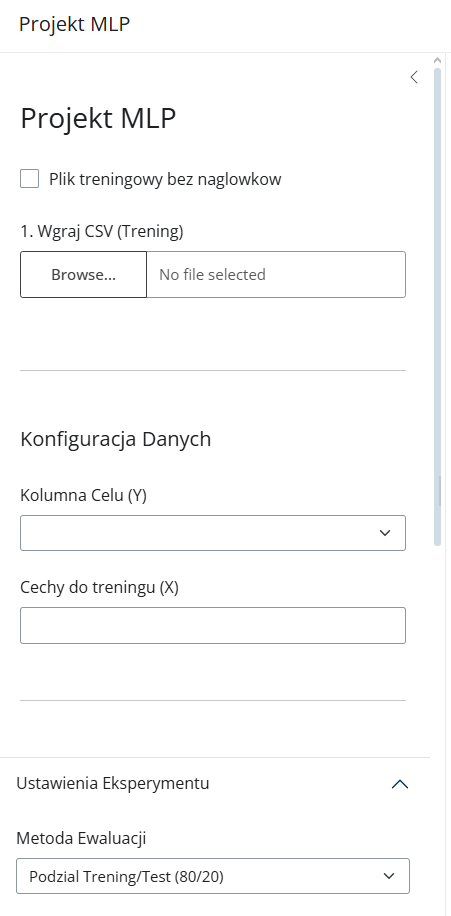

# MLP Classifier Lab

Interaktywna aplikacja webowa do **trenowania, ewaluacji i używania klasyfikatora opartego na wielowarstwowej sieci neuronowej (MLP)**. Wczytujesz dowolny plik CSV, wybierasz cechy i parametry sieci, porównujesz metody walidacji, a potem używasz wytrenowanego modelu do predykcji. Wszystko działa w przeglądarce, bez pisania kodu.

Zbudowana w **Pythonie** z użyciem **scikit-learn** i **Shiny for Python**.

<p align="center">
  
</p>

## Funkcje

- **Wczytywanie danych z CSV**: automatyczne wykrywanie separatora (`,` lub `;`), obsługa plików bez nagłówka
- **Wybór kolumny celu i cech**: aplikacja sama podpowiada kolumny nadające się na cel klasyfikacji
- **Konfiguracja sieci**:
  - architektura warstw ukrytych (np. `100,50`),
  - funkcja aktywacji: ReLU, Tanh, Sigmoid,
  - solver: Adam, SGD, LBFGS,
  - liczba epok,
  - regularyzacja L2 (`alpha`)
- **Cztery metody ewaluacji**: podział 80/20, Stratified k-Fold, ShuffleSplit, Leave-One-Out
- **Zarządzanie danymi**: wykluczanie wybranych wierszy z treningu i testowanie na nich modelu (holdout)
- **Wyniki**: metryki, macierz pomyłek i krzywa straty
- **Predykcja** w trzech trybach: pojedynczy przypadek (formularz generowany na podstawie cech), dane wykluczone, zewnętrzny plik CSV z pobraniem wyników
- **Eksport modelu** do pliku `.pkl` razem z pipeline'em przetwarzania danych

## Zrzuty ekranu

<table>
  <tr>
    <td align="center" width="50%">
      
      <br><sub><b>Dane</b>: podgląd i wykluczanie wierszy</sub>
    </td>
    <td align="center" width="50%">
      
      <br><sub><b>Wyniki</b>: metryki, macierz pomyłek, krzywa straty</sub>
    </td>
  </tr>
  <tr>
    <td align="center" width="50%">
      
      <br><sub><b>Predykcja</b>: pojedynczy przypadek, holdout, plik CSV</sub>
    </td>
    <td align="center" width="50%">
      
      <br><sub><b>Panel boczny</b>: konfiguracja danych i sieci</sub>
    </td>
  </tr>
</table>

## Jak to działa

### Przetwarzanie danych

Przed treningiem dane przechodzą przez `ColumnTransformer` ze scikit-learn:

| Krok | Szczegóły |
|---|---|
| Czyszczenie | konwersja liczb zapisanych z przecinkiem (`3,5` → `3.5`), usunięcie wierszy z brakami |
| Cechy liczbowe | standaryzacja (`StandardScaler`) |
| Cechy kategoryczne | kodowanie (`OrdinalEncoder`), nieznane wartości przy predykcji kodowane jako `-1` |

Preprocessor zapisywany jest razem z modelem, więc nowe dane przy predykcji przechodzą dokładnie te same transformacje co dane treningowe.

### Ewaluacja

| Metoda | Opis |
|---|---|
| Train/test 80/20 | jeden losowy podział, najszybsza |
| Stratified k-Fold | `k` podziałów z zachowaniem proporcji klas, stabilniejszy wynik |
| ShuffleSplit | 10 losowych podziałów 80/20 |
| Leave-One-Out | `n` treningów, każda próbka raz jako test, najdokładniejsza i najwolniejsza |

Przy walidacji krzyżowej predykcje zbierane są przez `cross_val_predict`, a model końcowy trenowany jest na całym zbiorze. Wszystkie metody używają stałego `random_state`, więc wyniki są powtarzalne.

### Metryki

Accuracy, Balanced Accuracy, Precision, Sensitivity (Recall), Specificity, F1 i wartość funkcji straty. Metryki liczone są w wersji **macro**, czyli każda klasa ma taką samą wagę. Specificity nie ma gotowej funkcji w scikit-learn, więc jest wyliczana ręcznie z macierzy pomyłek dla każdej klasy (TN / (TN + FP)) i uśredniana.

## Struktura projektu

```
├── app.py            # interfejs (Shiny): panel boczny, zakładki, logika reaktywna
├── logic.py          # wczytywanie, preprocessing, trening, metryki, wykresy, zapis modelu
├── dokumentacja.md   # pełna dokumentacja z instrukcją obsługi
└── screen/           # zrzuty ekranu
```

Logika ML (`logic.py`) jest oddzielona od interfejsu (`app.py`), więc funkcje treningu i ewaluacji można używać i testować bez uruchamiania aplikacji.

## Uruchomienie

Wymagania: Python 3.10+.

```bash
git clone https://github.com/Poudretteite/ISI.git
cd ISI
pip install shiny pandas numpy scikit-learn matplotlib seaborn joblib
shiny run app.py
```

Aplikacja otworzy się pod `http://127.0.0.1:8000`.

### Przykładowe dane

Aplikację testowano na publicznych zbiorach:
- [Iris](https://archive.ics.uci.edu/dataset/53/iris)
- [Fruit Classification Dataset](https://github.com/awal40/apa/blob/main/fruit_classification_dataset.csv)

## Technologie

Python · scikit-learn (`MLPClassifier`, `ColumnTransformer`, walidacja krzyżowa) · pandas · NumPy · Matplotlib · Seaborn · joblib · Shiny for Python

---

Szczegółowy opis interfejsu i scenariusze użycia znajdziesz w [dokumentacja.md](dokumentacja.md).
